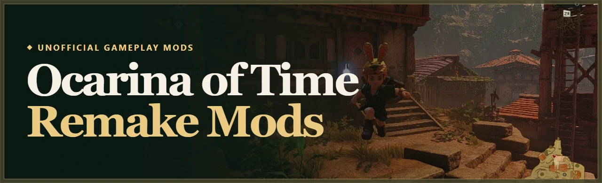
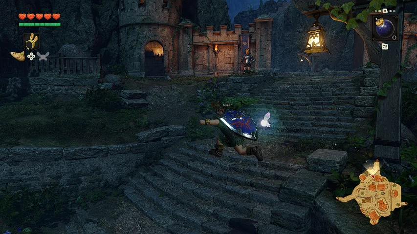

<h1 align="center">
  
</h1>

  Equipment, movement, and ocarina mods for the Nintendo Switch 2 remake.

  
  

  
  
  

## Gameplay mods

<table>
  <tr>
    <td width="50%">
       
      <strong>Classic Ledge Jump</strong>
    </td>
    <td width="50%">
       
      <strong>Lens and Mask</strong>
    </td>
  </tr>
</table>

| Mod | What it changes | Release notes |
| :-- | :-- | :-- |
| [TOTK-style Arrow Recovery](https://ripdzl.github.io/OOT-Remake-Mods/#totk-style-arrow-recovery) | Recover missed normal arrows with an embedded-arrow effect and white pickup sparkle. | [v0.0.7–0.0.8](https://github.com/ripDZL/OOT-Remake-Mods/releases/tag/totk-style-arrow-recovery-v0.0.8) |
| [Lens and Mask](https://ripdzl.github.io/OOT-Remake-Mods/#lens-and-mask) | Toggle your mask while the Lenses of Truth stay active. | [v1.0.1–1.0.2](https://github.com/ripDZL/OOT-Remake-Mods/releases/tag/lens-and-mask-v1.0.2) |
| [Mask Menu Unlock](https://ripdzl.github.io/OOT-Remake-Mods/#mask-menu-unlock) | Cycle through eight masks from Equipment after completing the Mask of Truth trading quest. | [v1.0.2–1.0.3](https://github.com/ripDZL/OOT-Remake-Mods/releases/tag/mask-menu-unlock-v1.0.3) |
| [Classic Ledge Jump](https://ripdzl.github.io/OOT-Remake-Mods/#classic-ledge-jump) | Restore the automatic jump when running off a ledge. | [v1.1.0 test](https://github.com/ripDZL/OOT-Remake-Mods/releases/tag/classic-ledge-jump-v1.1.0) |
| [Bunny Hood Speed Boost](https://ripdzl.github.io/OOT-Remake-Mods/#bunny-hood-speed-boost) | Run faster while wearing the Bunny Hood. | [Revision 2](https://github.com/ripDZL/OOT-Remake-Mods/releases/tag/bunny-hood-speed-boost-r2) |
| [Songbook Autoplay](https://ripdzl.github.io/OOT-Remake-Mods/#songbook-autoplay) | Play learned ocarina songs directly from the songbook. | [v1.0.2](https://github.com/ripDZL/OOT-Remake-Mods/releases/tag/songbook-autoplay-v1.0.2) |

## Installation

Use **game version 1.1.1** and choose the ZIP for your platform. [Mod catalog](https://ripdzl.github.io/OOT-Remake-Mods/#mods)

| Tested Windows build | Mod manager | Setup |
| :-- | :-- | :-- |
| Triforce v0.8.0 | [Triforce Manager v0.1.6 beta](https://github.com/ripDZL/OOT-Remake-Mods/releases/tag/triforce-mod-manager-v0.1.6) | [Triforce setup](https://ripdzl.github.io/OOT-Remake-Mods/#install-triforce) |
| Longshot v3.2.0 | [Longshot Manager v0.1.3 beta](https://github.com/ripDZL/OOT-Remake-Mods/releases/tag/longshot-mod-manager-v0.1.3) | [Longshot setup](https://ripdzl.github.io/OOT-Remake-Mods/#install-longshot) |

Build the base game first. Drop the shared Triforce / Longshot ZIPs into your manager, enable the mods, and click **Play**. Both managers show build progress in a live terminal and let you cancel a running build.

- **Legacy Hookshot v3.0.2 on Windows.** If you already have a working Hookshot v3.0.2 build, use the Hookshot ZIPs with [Hookshot Mod Manager v0.1.2 beta](https://github.com/ripDZL/OOT-Remake-Mods/releases/tag/hookshot-mod-manager-v0.1.2).
- **Lichii build 410 and Fritchii v6.5.** Extract the matching ZIP into the game's mod folder, then enable it in the emulator. [Emulator setup guide](https://ripdzl.github.io/OOT-Remake-Mods/#install-lichii)
- **Switch 2 hardware tests.** Select releases have dedicated test ZIPs. Physical console compatibility is unverified. [Hardware test guide](https://ripdzl.github.io/OOT-Remake-Mods/#install-switch-2)

## Compatibility

The shared Windows ZIPs loaded together on Triforce v0.8.0 and Longshot v3.2.0. Live tests verified the code patches, arrow recovery and Bunny Hood toggles on both. The same six mods loaded together on Lichii build 410 and Fritchii v6.5, with the same arrow and Bunny Hood checks. Earlier Hookshot and emulator tests also exercised mask and Lens controls, ledge jumps and Songbook Autoplay.

| Mod | Triforce v0.8.0 / Longshot v3.2.0 | Hookshot v3.0.2 (legacy) | Lichii 410 | Fritchii v6.5 | Switch 2 |
| :-- | :-- | :-- | :-- | :-- | :-- |
| TOTK-style Arrow Recovery | v0.0.7 | v0.0.7 | v0.0.8 | v0.0.7 | — |
| Lens and Mask | v1.0.1 | v1.0.1 | v1.0.2 | v1.0.2 | — |
| Mask Menu Unlock | v1.0.2 | v1.0.2 | v1.0.2 | v1.0.3 | — |
| Classic Ledge Jump | v1.1.0 test | v1.1.0 test | v1.1.0 test | v1.1.0 test | Hardware test |
| Bunny Hood Speed Boost | Revision 2 | Revision 2 | Revision 2 | Revision 2 | Hardware test |
| Songbook Autoplay | v1.0.2 | v1.0.2 | v1.0.2 | v1.0.2 | Hardware test |

**Hardware test** packages are available for the listed mods. Physical console compatibility is unverified.

Use **Dynamic FPS** with the full Lichii collection. The separate FPS Unlock conflicts with Songbook Autoplay. Fritchii's main High Refresh mode works with the collection. Its additional High Refresh fixes are skipped. Start at 60 FPS.

Use the ZIP for your platform. **Enable one Arrow Recovery edition at a time** and keep its packaged folder name. Recovery covers normal arrows. Trees, water, full quivers, minigames, and long-session cleanup still need broader testing.

## Report an issue

Include the mod version, platform build, other enabled mods, and steps to reproduce. [File a bug report](https://github.com/ripDZL/OOT-Remake-Mods/issues/new?template=bug-report.yml)

---

Unofficial fan project. Mods developed with Codex assistance. Game and screenshots © Nintendo.
