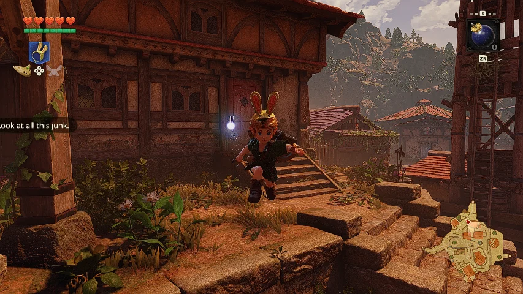

# Ocarina of Time Remake Mods

Gameplay mods for the **Nintendo Switch 2 remake · game version 1.1.1**.

**[Browse the mod catalog](https://ripdzl.github.io/OOT-Remake-Mods/)** · [Installation guides](https://ripdzl.github.io/OOT-Remake-Mods/#install) · [GitHub Releases](https://github.com/ripDZL/OOT-Remake-Mods/releases)

## Gameplay mods

| Mod | What it changes |
| --- | --- |
| [Lens and Mask](https://ripdzl.github.io/OOT-Remake-Mods/#lens-and-mask) | Toggle your mask while the Lenses of Truth stay active. |
| [Mask Menu Unlock](https://ripdzl.github.io/OOT-Remake-Mods/#mask-menu-unlock) | Cycle through eight masks in Equipment after completing the Mask of Truth trading quest. |
| [Classic Ledge Jump](https://ripdzl.github.io/OOT-Remake-Mods/#classic-ledge-jump) | Bring back the automatic running jump off ledges. |
| [Bunny Hood Speed Boost](https://ripdzl.github.io/OOT-Remake-Mods/#bunny-hood-speed-boost) | Run faster while wearing the Bunny Hood. |
| [Songbook Autoplay](https://ripdzl.github.io/OOT-Remake-Mods/#songbook-autoplay) | Play learned ocarina songs directly from the songbook. |

Lens and Mask v1.0.1 works alongside Mask Menu Unlock v1.0.2 and Classic Ledge Jump. The two equipment mods have separate ZIPs tested on **Triforce v0.4.0**, **Hookshot v2.3.2**, **Lichii build 316**, and **Fritchii v5.8.4**.

## Choose your platform

| Platform | How to install |
| --- | --- |
| **Triforce · Windows** | Build the game in Triforce Setup, then import the Triforce ZIP into [Triforce Mod Manager](https://github.com/ripDZL/OOT-Remake-Mods/releases/tag/triforce-mod-manager-v0.1.1). |
| **Hookshot · Windows** | Build the game in Hookshot Builder, then import the Hookshot ZIP into [Hookshot Mod Manager](https://github.com/ripDZL/OOT-Remake-Mods/releases/tag/hookshot-mod-manager-v0.1.1). |
| **Lichii or Fritchii** | Extract the matching ZIP to the game's mod folder. Check the tested emulator build on the [catalog](https://ripdzl.github.io/OOT-Remake-Mods/#mods). |
| **Switch 2** | Follow the [hardware test guide](https://ripdzl.github.io/OOT-Remake-Mods/#install-switch-2) for mods with a hardware test ZIP. Physical console compatibility is unverified. |

For a bug report, include the mod version, your platform and build, and what you were doing when it happened. [Open an issue](https://github.com/ripDZL/OOT-Remake-Mods/issues)

---

Unofficial fan project. Mods developed with Codex assistance. Game and screenshots © Nintendo.
