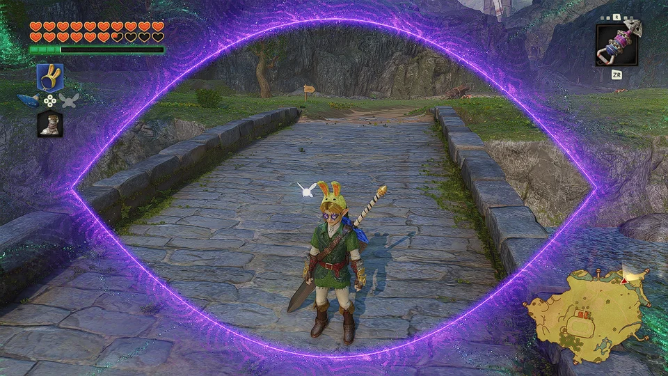

<h1 align="center">Ocarina of Time Remake Mods</h1>

  Equipment, movement, and ocarina mods for the Nintendo Switch 2 remake.

  
  
  

  <strong><a href="https://ripdzl.github.io/OOT-Remake-Mods/#mods">Browse &amp; download mods</a></strong>

   
  Lens and Mask · In-game capture

## Gameplay mods

| Mod | What it changes | Release notes |
| :-- | :-- | :-- |
| [TOTK-style Arrow Recovery](https://ripdzl.github.io/OOT-Remake-Mods/#totk-style-arrow-recovery) | Recover missed normal arrows with an embedded-arrow effect and white pickup sparkle. | [v0.0.7–0.0.8](https://github.com/ripDZL/OOT-Remake-Mods/releases/tag/totk-style-arrow-recovery-v0.0.8) |
| [Lens and Mask](https://ripdzl.github.io/OOT-Remake-Mods/#lens-and-mask) | Toggle your mask while the Lenses of Truth stay active. | [v1.0.1–1.0.2](https://github.com/ripDZL/OOT-Remake-Mods/releases/tag/lens-and-mask-v1.0.2) |
| [Mask Menu Unlock](https://ripdzl.github.io/OOT-Remake-Mods/#mask-menu-unlock) | Cycle through eight masks from Equipment after completing the Mask of Truth trading quest. | [v1.0.2–1.0.3](https://github.com/ripDZL/OOT-Remake-Mods/releases/tag/mask-menu-unlock-v1.0.3) |
| [Classic Ledge Jump](https://ripdzl.github.io/OOT-Remake-Mods/#classic-ledge-jump) | Restore the automatic jump when running off a ledge. | [v1.1.0 test](https://github.com/ripDZL/OOT-Remake-Mods/releases/tag/classic-ledge-jump-v1.1.0) |
| [Bunny Hood Speed Boost](https://ripdzl.github.io/OOT-Remake-Mods/#bunny-hood-speed-boost) | Run faster while wearing the Bunny Hood. | [Revision 2](https://github.com/ripDZL/OOT-Remake-Mods/releases/tag/bunny-hood-speed-boost-r2) |
| [Songbook Autoplay](https://ripdzl.github.io/OOT-Remake-Mods/#songbook-autoplay) | Play learned ocarina songs directly from the songbook. | [v1.0.2](https://github.com/ripDZL/OOT-Remake-Mods/releases/tag/songbook-autoplay-v1.0.2) |

## Installation

Use **game version 1.1.1** and choose the ZIP for your platform from the [mod catalog](https://ripdzl.github.io/OOT-Remake-Mods/#mods).

- **Triforce v0.6.0 and Hookshot v3.0.2 on Windows.** Build the base game first. Drop the ZIP into the matching manager, enable the mod, and click **Play**. The first launch with a new code mod selection can take several minutes. [Triforce Mod Manager v0.1.3 beta](https://github.com/ripDZL/OOT-Remake-Mods/releases/tag/triforce-mod-manager-v0.1.3) · [Hookshot Mod Manager v0.1.2 beta](https://github.com/ripDZL/OOT-Remake-Mods/releases/tag/hookshot-mod-manager-v0.1.2)
- **Lichii build 366 and Fritchii v6.2.** Extract the matching ZIP into the game's mod folder, then enable it in the emulator. [Emulator setup guide](https://ripdzl.github.io/OOT-Remake-Mods/#install-lichii)
- **Switch 2 hardware tests.** Select releases have dedicated test ZIPs. Physical console compatibility is unverified. [Hardware test guide](https://ripdzl.github.io/OOT-Remake-Mods/#install-switch-2)

## Compatibility

All six gameplay mods were tested together on the Windows builds below, including arrow pickup, all eight masks, Lens controls, Bunny Hood movement, automatic ledge jumps, and Songbook Autoplay.

| Mod | Triforce v0.6.0 | Hookshot v3.0.2 | Lichii 366 | Fritchii v6.2 | Switch 2 |
| :-- | :-- | :-- | :-- | :-- | :-- |
| TOTK-style Arrow Recovery | v0.0.7 | v0.0.7 | v0.0.8 | v0.0.7 | — |
| Lens and Mask | v1.0.1 | v1.0.1 | v1.0.2 | v1.0.2 | — |
| Mask Menu Unlock | v1.0.2 | v1.0.2 | v1.0.2 | v1.0.3 | — |
| Classic Ledge Jump | v1.1.0 test | v1.1.0 test | v1.1.0 test | v1.1.0 test | Hardware test |
| Bunny Hood Speed Boost | Revision 2 | Revision 2 | Revision 2 | Revision 2 | Hardware test |
| Songbook Autoplay | v1.0.2 | v1.0.2 | v1.0.2 | v1.0.2 | Hardware test |

**Hardware test** packages are available for the listed mods. Physical console compatibility is unverified.

Use **Dynamic FPS** with the full Lichii collection. The separate FPS Unlock conflicts with Songbook Autoplay. Fritchii's main High Refresh mode works with the collection. Its additional High Refresh fixes are skipped. Start at 60 FPS.

Use the ZIP for your platform. **Enable one Arrow Recovery edition at a time** and keep its packaged folder name. Recovery covers normal arrows. Trees, water, full quivers, minigames, and long-session cleanup still need broader testing.

## Report an issue

Include the mod version, platform build, other enabled mods, and steps to reproduce. [File a bug report](https://github.com/ripDZL/OOT-Remake-Mods/issues/new?template=bug-report.yml)

---

Unofficial fan project. Mods developed with Codex assistance. Game and screenshots © Nintendo.
